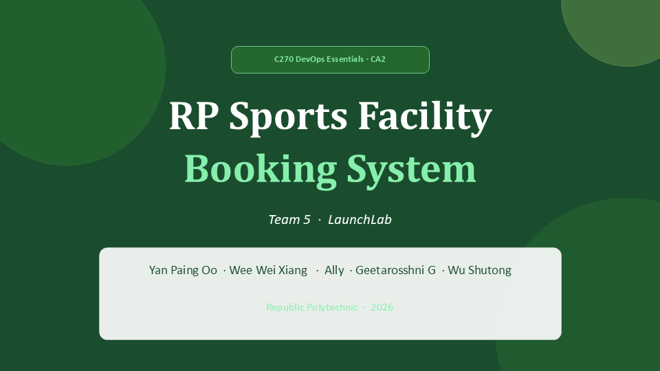
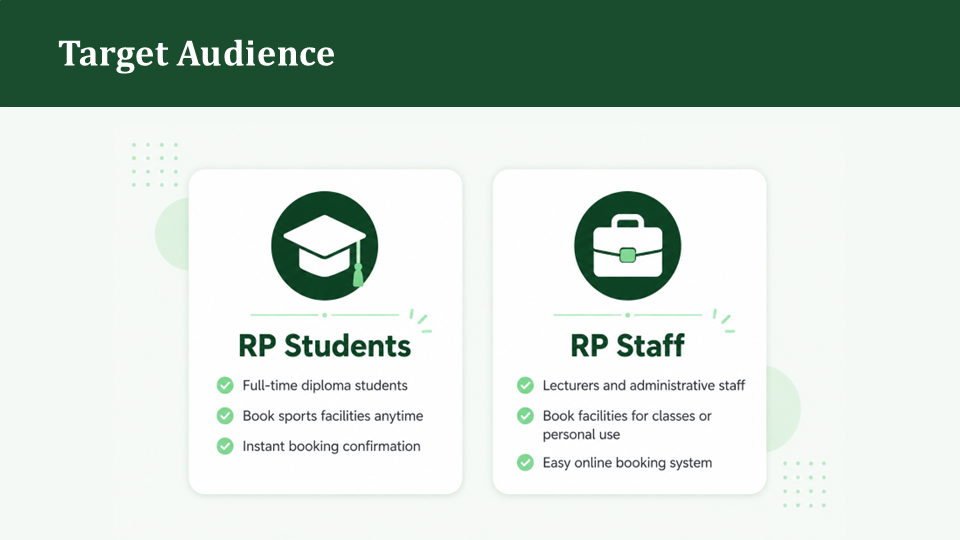
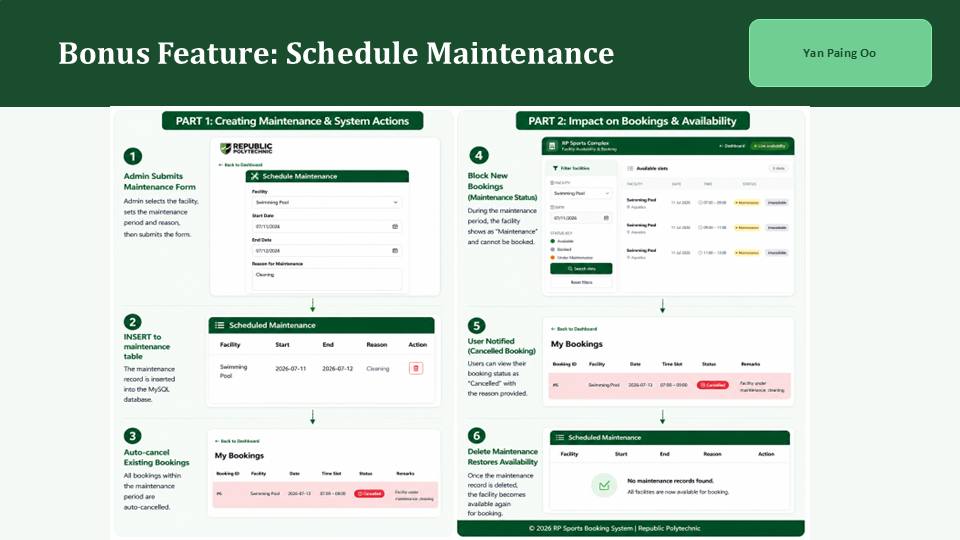

# RP Sports Complex — Facility Booking System

A web application for booking sports facilities at Republic Polytechnic, built as a two-phase project: **Phase 1** delivered the core application, and **Phase 2** containerized, automated, and deployed it to the cloud using a full DevOps pipeline.

<p align="center">
  
</p>

---

## Table of Contents

- [Phase 1 — Application Features](#phase-1--application-features)
- [Phase 2 — DevOps Implementation](#phase-2--devops-implementation)
- [Tech Stack](#tech-stack)
- [Project Structure](#project-structure)
- [Setup & Run Instructions](#setup--run-instructions)
- [Environment Variables](#environment-variables)
- [CI/CD Pipeline](#cicd-pipeline)
- [Presentation Slides](#presentation-slides)

---

## Phase 1 — Application Features

### Authentication & Account Management
- User registration restricted to RP student/staff emails (`@myrp.edu.sg` / `@rp.edu.sg`)
- Login / logout with hashed passwords (bcrypt)
- Forgot password flow with **email-based verification codes** (Nodemailer)
- Password reset after successful code verification
- Role-based access: `user` vs `admin`

### Facility Search & Availability
- Filter facilities by name and date
- Live availability grid showing **Available / Booked / Under Maintenance** status per time slot
- Automatically closed on Sundays and public holidays
- Auto-hides time slots that have already passed for the current day

### Bookings
- Book any available time slot directly from the search page
- View personal booking history
- Cancel a booking as a user
- Prevents double-booking the same facility/date/time

### Facility Management (Admin)
- Add, edit, and delete facilities
- View full facility details (capacity, category, location, equipment, description)

### Maintenance Scheduling (Admin)
- Schedule a facility as unavailable across a date range
- Automatically cancels any existing bookings that fall within the maintenance window
- Notifies affected users of cancellations (shown as an alert on next login)

### Notifications
- In-app alert when a user's booking has been cancelled (e.g. due to maintenance)
- Booking reminder API endpoint (`/api/bookings/reminders`)

---

## Phase 2 — DevOps Implementation

### Containerization
- **Dockerfile** — packages the Node.js/Express app into a portable image
- **.dockerignore** — excludes `node_modules`, `.env`, and `.git` from the built image

### Multi-Container Orchestration (Docker Compose)
- **`app`** — the Node.js/Express application
- **`nginx`** — reverse proxy, routes external traffic on port 80 to the app on port 3000 internally, and lays the groundwork for future HTTPS support

### Cloud Database (AWS RDS)
- Migrated from local MySQL to a managed **AWS RDS MySQL** instance
- `db.js` reads all connection details from environment variables — zero hardcoded credentials, zero code changes required when switching between local and cloud databases

### Infrastructure as Code (Ansible)
- `ansible/playbook.yml` automatically provisions a fresh AWS EC2 instance: updates packages, installs Docker and the Docker Compose plugin, and configures user permissions
- Means the deployment server can be rebuilt from scratch with a single command, no manual setup

### CI/CD Pipeline (Jenkins)
Fully automated pipeline covering the entire code → deploy lifecycle:
1. Checkout latest code from GitHub
2. Provision/update EC2 infrastructure via Ansible
3. Install dependencies (`npm install`)
4. Run automated tests (`npm test`)
5. Build the Docker image
6. **Scan the image for vulnerabilities (Trivy)**
7. Archive the security scan report as a build artifact
8. Verify the build environment
9. Deploy to AWS EC2 over SSH (pulls latest code, rebuilds and restarts containers)
10. Verify the deployment succeeded

### DevSecOps — Vulnerability Scanning (Trivy)
- `trivy-scan.sh` — a standalone, reusable bash script that scans the built Docker image for HIGH and CRITICAL vulnerabilities
- Runs automatically as a Jenkins pipeline stage; results are archived as a downloadable report on every build

### Automated Testing
- Test suite built with **Jest** and **Supertest**, covering authentication, bookings, and facility routes
- Tests run automatically in the pipeline — a failing test blocks deployment

### Security Practices
- `.gitignore` excludes `.env`, `db.js`, and `*.pem` (SSH private key) — no secrets are ever committed to GitHub
- All credentials (database, email) are supplied via environment variables at runtime

---

## Tech Stack

| Layer | Technology |
|---|---|
| Backend | Node.js, Express |
| Views | EJS, Bootstrap 5 |
| Database | MySQL (AWS RDS in production) |
| Auth | bcryptjs, express-session |
| Email | Nodemailer |
| Testing | Jest, Supertest |
| Containerization | Docker, Docker Compose |
| Reverse Proxy | Nginx |
| CI/CD | Jenkins |
| Infrastructure as Code | Ansible |
| Security Scanning | Trivy |
| Cloud Hosting | AWS EC2 + AWS RDS |

---

## Project Structure

```
C270-DevOps-Team5/
├── ansible/                  # Infrastructure as Code for EC2 provisioning
│   ├── ansible.cfg
│   ├── inventory.ini
│   └── playbook.yml
├── public/                   # Static assets
├── routes/                   # Express route handlers
│   ├── auth.js
│   ├── bookings.js
│   └── facilities.js
├── tests/                    # Jest/Supertest test suite
├── views/                    # EJS templates
├── Slides/                   # Presentation slide previews
├── app.js                    # Application entry point
├── db.js                     # Database connection (env-var driven)
├── init.sql                  # Database schema + seed data
├── Dockerfile                # App container definition
├── docker-compose.yml        # Multi-container orchestration (app + nginx)
├── nginx.conf                # Reverse proxy configuration
├── Jenkinsfile                # CI/CD pipeline definition
├── trivy-scan.sh             # Vulnerability scanning script
├── package.json
└── README.md
```

---

## Setup & Run Instructions

### Prerequisites
- [Docker Desktop](https://www.docker.com/products/docker-desktop/) installed and running
- Node.js 22+ (only required if running without Docker)
- A MySQL database — either a local instance, a local Docker container, or AWS RDS

### 1. Clone the repository
```bash
git clone https://github.com/WeiXiangWee/C270-DevOps-Team5.git
cd C270-DevOps-Team5
```

### 2. Create your `.env` file
Create a file named `.env` in the project root with the following:
```dotenv
DB_HOST=your_database_host
DB_USER=your_database_user
DB_PASSWORD=your_database_password
DB_NAME=c270
PORT=3000

EMAIL_USER=your_email_here
EMAIL_PASS=your_email_app_password
```
> `.env` is excluded from Git — you will need to create this yourself and obtain the real email credentials from a teammate.

### 3a. Run with Docker Compose (recommended)
```bash
docker compose up --build
```
Visit **http://localhost** (routed through Nginx) or **http://localhost:3000** (direct to the app) in your browser.

To stop:
```bash
docker compose down
```

### 3b. Run without Docker
```bash
npm install
node app.js
```
Visit **http://localhost:3000**.

### Running Tests
```bash
npm test
```

### Running a Manual Vulnerability Scan
```bash
chmod +x trivy-scan.sh
./trivy-scan.sh c270-devops-team5 HIGH,CRITICAL false
```

---

## Environment Variables

| Variable | Description |
|---|---|
| `DB_HOST` | Database hostname (`db` for a local Docker container, or your RDS endpoint) |
| `DB_USER` | Database username |
| `DB_PASSWORD` | Database password |
| `DB_NAME` | Database name (`c270`) |
| `PORT` | Port the app listens on (`3000`) |
| `EMAIL_USER` | Gmail account used to send verification/reset emails |
| `EMAIL_PASS` | Gmail App Password for the above account |

---

## CI/CD Pipeline

The `Jenkinsfile` defines a pipeline that runs automatically on every push:

```
Checkout → Ansible (provision EC2) → Install Deps → Run Tests
   → Build Docker Image → Trivy Vulnerability Scan → Archive Report
   → Verify Build → Deploy to EC2 → Verify Deployment
```

Deployment connects to the EC2 instance over SSH, pulls the latest code, and rebuilds/restarts the containers with:
```bash
docker compose down
docker compose up -d --build
```

---

## Presentation Slides

<p align="center">
  <br><br>
  <br><br>
  <br><br>
  <br><br>
  <br><br>
  <br><br>
  <br><br>
  <br><br>
  <br><br>
  <br><br>
  <br><br>
  <br><br>
  
</p>
